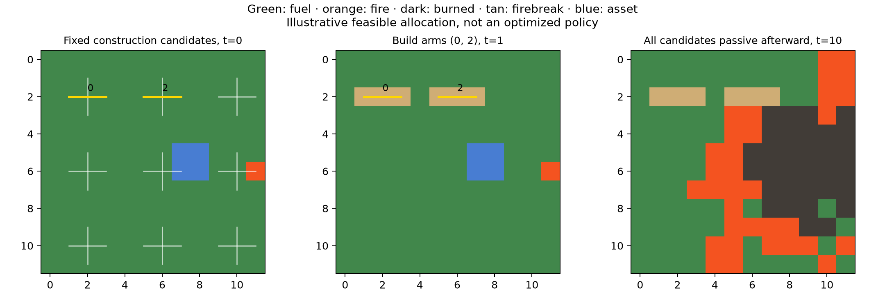

# Deep Reinforcement Learning for Constrained Wildfire Resource Allocation

**CRMAB defines the allocation problem → the grid implements its physical
transitions → DQN learns a feasible allocation policy.**

Each arm is a fixed candidate firebreak segment. Activating an eligible arm
constructs that segment permanently. Every other candidate remains passive while
fire continues spreading around it. A decision can construct **two segments
simultaneously**, subject to an episode material budget and spatial conflicts.

This is a **spatially coupled, single-construction CRMAB extension**. Fire can
spread between candidate neighbourhoods and construction can change another arm's
transition. It is not Kaza et al.'s independent-arm model, and inherits no
indexability or optimality claims. The [formulation](docs/FORMULATION.md) states
the mathematical extension and observation assumptions explicitly.

## Read the project in this order

**New to RL, DQN or CRMAB? Start with the [beginner's guide](docs/BEGINNERS_GUIDE.md).**
It explains the ideas from scratch, walks through actual code snippets, and includes
worked examples, runnable exercises and a glossary.

1. [Mathematical formulation](docs/FORMULATION.md): arms, joint dynamics, resources,
   rewards, wind and simultaneous allocation.
2. [Code guide](docs/ARCHITECTURE.md): each directory, file and data structure.
3. [Audit and mathematics-to-code map](docs/AUDIT.md): what changed and what was reused.
4. [Validation](docs/VALIDATION.md): checks, measured comparisons and limitations.

**Start with the simple demo:** open [the animation](demo/simple_demo.gif).
The [short Python script](demo/simple_demo.py) loads a policy, runs one incident,
and saves a GIF. The [simple demo guide](demo/SIMPLE_DEMO.md) explains how to present it.

**Optional detailed dashboard:** open [demo/demo.html](demo/demo.html) in a browser. It includes
real saved-model replays, step/play controls, arm inspection, feasible DQN Q-values,
the actual architecture and measured results. For other seeds and budgets, run
`.venv/bin/python demo/server.py --port 8765` and open `http://127.0.0.1:8765`.
See the [demo guide](demo/README.md).

## Directory structure

```text
research/
├── configs/                       # smoke, pilot, larger research protocol
├── docs/                          # equations, assumptions and reading guide
├── demo/                          # browser replay, actual model inspection, local API
├── examples/                      # small runnable demonstrations
├── src/wildfire_crmab/
│   ├── environment/
│   │   ├── config.py              # physical and allocation parameters
│   │   ├── arms.py                # candidate geometry and evolving arm states
│   │   ├── allocations.py         # complete subsets and hard feasibility
│   │   ├── scenario.py            # vegetation, ignition, wind, random fields
│   │   ├── spread.py              # synchronous wind-driven ignition model
│   │   └── env.py                 # construct → spread → account → observe
│   ├── agents/
│   │   ├── observations.py        # observation/mask schema validation
│   │   ├── network.py             # joint-allocation Q network and targets
│   │   ├── replay.py              # experience storage with both masks
│   │   ├── dqn.py                 # exploration, learning and model saving
│   │   ├── checkpoints.py         # environment/catalogue identity metadata
│   │   └── baselines.py           # no build, random and placement heuristics
│   ├── training/train.py          # learning loop and validation selection
│   ├── evaluation/
│   │   ├── scenarios.py           # separate validation/test worlds
│   │   ├── runner.py              # common rollout for every policy
│   │   ├── compare.py             # frozen checkpoint comparisons
│   │   ├── statistics.py          # matched differences and uncertainty
│   │   └── report.py              # result tables and PDF/PNG figures
│   ├── utils/io.py                # JSON and CSV output
│   ├── config.py                  # experiment setting validation
│   └── cli.py                     # commands connecting the components
├── tests/
│   ├── environment/               # physical dynamics and CRMAB constraints
│   ├── agents/                    # feasible DQN learning and baselines
│   ├── training/                  # complete training/evaluation integration
│   └── evaluation/                # paired experiments and statistics
├── results/                       # compact measured comparison snapshots
└── artifacts/                     # complete runs, weights and source snapshots
```

## Run

Python 3.11+ with compatible PyTorch wheels. This workspace already has a local
`.venv` with the dependencies installed. From `research`:

```bash
source .venv/bin/activate
python -m pytest -q
python examples/one_allocation.py
wildfire-crmab run --config configs/smoke.json --output artifacts/my-smoke
wildfire-crmab run --config configs/pilot.json --output artifacts/my-pilot
```

For a fresh checkout:

```bash
python -m venv .venv
source .venv/bin/activate
python -m pip install torch --index-url https://download.pytorch.org/whl/cpu
python -m pip install -e '.[dev]'
```

The verified CPU versions are in `requirements-cpu.lock.txt`; install that file
and then `pip install -e '.[dev]' --no-deps` for matching package versions.
`python -m wildfire_crmab` is equivalent to `wildfire-crmab`. A run must use a new
output directory; it never overwrites an existing experiment. Checkpoints support
inference, not interrupted-training resume.

```bash
# Re-evaluate the saved best checkpoints using their fixed test suite.
wildfire-crmab evaluate --run-dir artifacts/my-pilot

# Larger, unexecuted protocol; assess convergence before research claims.
wildfire-crmab run --config configs/research.json --output artifacts/my-research
```

## Default problem and comparisons

The 12×12 grid has uniform vegetation, one edge ignition, a 2×2 protected asset,
18 fixed length-three candidate segments and **163 complete allocation actions**.
Capacity is two segments per fire interval. Each costs one material unit; default
episode budget is six. Experiments compare budgets 2, 4 and 6. Wind is constant
within each episode and sampled across episodes. Eight-neighbour spread permits
diagonal bypass around short segments.



Regenerate this illustration with `python examples/plot_allocation.py`.

The two separately trained DQNs use exactly the same wind-driven simulator.
`dqn_no_wind` receives zeros in the two wind observation entries. Fire maps,
arm states, budgets, rewards and feasible masks match the wind-aware agent.
This tests the value of explicit wind information; it does not remove wind.
Setting `environment.wind_physics` to `false` defines a distinct physics ablation.

Baselines are no intervention, uniform random feasible allocation, immediate
threat placement without wind, and the same threat rule with wind. They receive
current observations and public model parameters, never future random draws.
Scores, raw outcomes, uncertainty intervals and preliminary findings are in
[the pilot results](results/pilot/RESULTS.md).

The simulator is synthetic and uncalibrated. DQN improvement is evaluated, not
assumed. Burned-or-cleared area counts vegetation sacrificed by construction.
Time-limit endings and remaining active fire are reported alongside protection.
