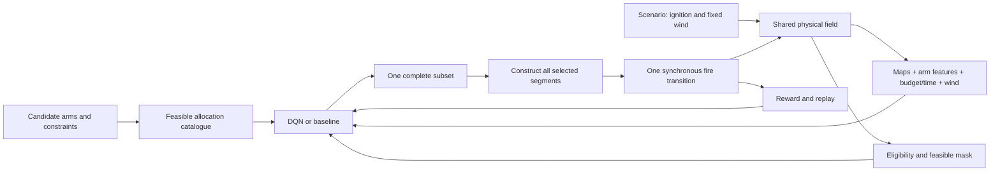

# Code reading guide

All paths below are relative to `src/wildfire_crmab/`. The environment does not
import PyTorch or policy classes. Agents consume observations and masks; they do
not read simulator state. Training and evaluation connect those interfaces.

## Environment: the allocation problem

Start with [`environment/config.py`](../src/wildfire_crmab/environment/config.py).
`EnvironmentConfig` gives dimensions, segment length, catalogue spacing, capacity,
material cost, budget, horizon, fire lifetime and wind influence. Changing geometry
requires retraining: output IDs refer to a fixed candidate catalogue.

[`environment/arms.py`](../src/wildfire_crmab/environment/arms.py) defines:

- `Segment`: stable ID, center, orientation and physical cells P_i.
- `CandidateArms`: catalogue, neighbourhood H_i, eligibility, features and snapshots.
- `ArmState`: built/eligible flags and neighbourhood arrays. Arrays are copied so
  a snapshot does not change after subsequent steps.

Default centers are rows and columns 2, 6 and 10 (zero based), with both orientations.
Horizontal/vertical candidates at the same center overlap and cannot be selected
together. Candidates intersecting the random protected asset become ineligible.
There is no action to construct outside this predeclared catalogue.

[`environment/allocations.py`](../src/wildfire_crmab/environment/allocations.py)
defines `AllocationCatalogue`. Its `subsets[j]` is the full list of arm IDs activated
by action j. Action zero is empty. `encode(ids)` and `decode(j)` convert between
representations. `incidence[j,i]` is the binary action vector; `costs[j]` is its
material cost. `mask(eligibility,budget)` combines dynamic site validity and
affordability. Capacity and disjointness are built into the catalogue itself.

The combinatorial upper bound is checked **before enumeration**. A limit failure
asks for a smaller catalogue/capacity instead of silently switching to sequential
interventions. The conservative bound may reject a case whose conflict-filtered
catalogue would fit. This is deliberate protection against excessive enumeration.

[`environment/scenario.py`](../src/wildfire_crmab/environment/scenario.py) separates
seeded layout, wind and spread streams. A `Scenario(seed,budget,wind=None)` defines
a world and resource limit. Changing budget leaves exogenous randomness identical.
An optional `(row_velocity,column_velocity)` overrides wind. The generated speed
is uniform in [0.3,0.9], with direction uniform over a circle.

[`environment/spread.py`](../src/wildfire_crmab/environment/spread.py) computes
one-step ignition probabilities from all current burning neighbours. `shifted`
never wraps a grid boundary. Fuel-zero firebreak cells have zero ignition risk.

[`environment/env.py`](../src/wildfire_crmab/environment/env.py) stores the shared
field and persistent per-candidate `built` bits. Read `step` in this order:

1. Decode and reject infeasible subsets before any mutation.
2. Clear every selected segment, set its build bit, charge its material cost.
3. Spread from one common snapshot and age every existing fire once.
4. Account for newly burned/cleared vegetation and asset damage.
5. Advance the physical clock once; report new arm features and feasible masks.

`arm_states()` exposes full local snapshots for inspection. `observation()` returns
compact arm features alongside the complete grid, because local patches alone
cannot predict incoming fire. Construction flags and clearance arrays have
different meanings: an overlapping site can be ineligible without ever being built.

## Agents: learning and placement rules

The observation contains:

| Entry | Shape | Meaning |
| --- | --- | --- |
| `map` | 6×12×12 | Fuel, burning, age/D, ever ignited, cleared, asset |
| `arms` | 18×10 | Explicit construction state and local physical features |
| `context` | 4 | Wind row/column, budget/fixed scale, remaining horizon fraction |

Arm columns in order: built, eligible, mean local fuel, local burning fraction,
mean local age/D, local ever-burned fraction, local cleared fraction, normalized
center row, normalized center column, vertical indicator. Every feature is in
[0,1]. Maps and build bits provide state information lost by those averages.

[`agents/network.py`](../src/wildfire_crmab/agents/network.py) encodes maps with a
CNN, arm features with a dense layer, then joins those with context. It outputs
one Q value per **complete subset**, 163 by default. `bellman_targets` uses:

    y = r                              at an episode boundary
    y = r + gamma max_(j feasible) Q_target(o_next,j) otherwise.

[`agents/dqn.py`](../src/wildfire_crmab/agents/dqn.py) implements masked epsilon
exploration, masked greedy action selection, Huber loss, gradient clipping and
target-network copying. It is vanilla DQN with a custom joint-allocation interface.
No Whittle index or independent per-arm Q decomposition is used.

[`agents/replay.py`](../src/wildfire_crmab/agents/replay.py) copies transitions and
their current/next masks, rejecting infeasible experience. All float arrays are
stored as float32. The default pilot buffer uses roughly 84 MB for two observation
arrays plus masks/metadata. `observations.py` validates schema and finite values;
`checkpoints.py` binds trained outputs to geometry, environment and visibility.

[`agents/baselines.py`](../src/wildfire_crmab/agents/baselines.py) contains four
policies. Threat rules sum immediate ignition risk over candidate cells, weighted
by distance to assets, then score complete subsets. They prefer fewer constructions
on ties. These are placement heuristics, not exact myopic maximizers of the full
reward or estimates of downstream protection. Random is uniform over feasible
subsets, not over their cardinalities.

## Training and evaluation: the experiment

[`training/train.py`](../src/wildfire_crmab/training/train.py) owns exploration,
replay updates and validation checkpoint selection. A training step means a
physical fire interval. Epsilon decays from 1 to .05 during the first 60% of
training. Validation uses greedy actions and chooses the largest discounted return,
retaining the earlier checkpoint on ties. No test results choose the checkpoint.

`evaluation/scenarios.py` defines fixed seed splits. `runner.py` is the common
episode loop and records time, resources and physical outcomes. `compare.py`
loads checkpoints, verifies catalogue identity and evaluates matched worlds.
`statistics.py` keeps repeated budgets within world clusters when bootstrapping
training seeds and worlds. `report.py` creates readable results and standalone
PNG/PDF figures. Weaker/stronger wind groups split episode speed at 0.6.

`cli.py` starts a new run, freezes the configuration, saves source snapshots and
hashes, trains both variants and evaluates them. `config.py` validates experiment
settings. `utils/io.py` handles JSON/CSV without policy or simulator logic.

Tests mirror these packages. The training integration test performs actual
optimization, checkpoint selection, reload and matched evaluation on a tiny suite.

The environment follows the Gymnasium reset/step/space interface with a strict
feasibility extension: callers must use `info["action_mask"]`. Unmasked
`action_space.sample()` may draw an infeasible catalogue entry and raise. The Gym
contract checker runs on the always-feasible capacity-zero configuration; separate
tests verify the full constrained configuration and its rejection semantics.
