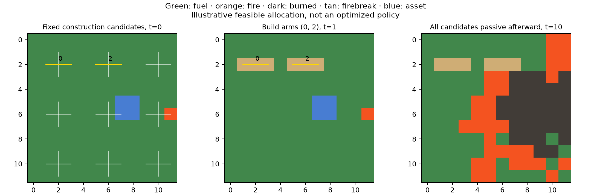

# From zero to understanding this wildfire RL project

**Project: Deep Reinforcement Learning for Constrained Wildfire Resource Allocation**

You do not need to know reinforcement learning, neural networks or bandits to start
this guide. We will first explain the problem in everyday language, then introduce
each technical idea when it becomes useful. Small numerical examples connect the
ideas to the actual implementation.

The three main pieces are:

> **CRMAB describes the allocation problem. The simulator implements that problem.
> DQN learns how to make allocation decisions.**

These pieces have different jobs. The simulator controls how fire spreads. The
learning algorithm controls which eligible firebreaks to construct.

## How to use this guide

Read sections 1–8 first for the problem and basic terminology. Read sections 9–17
for the learning process. Sections 18–24 connect everything to experiments, code
and the demo. You do not have to memorize the equations: read the explanation and
worked example beside each one.

**Code conventions:** blocks labelled **Actual project excerpt** are copied from
the linked source file. They are often parts of a class or function and should not
be pasted into a terminal by themselves. Blocks labelled **Runnable example** are
complete examples. Blocks labelled **Teaching example** use invented values to
explain an idea; they are not measured experimental results.

### Contents

1. [What problem are we solving?](#1-what-problem-are-we-solving)
2. [The minimum Python and maths vocabulary](#2-the-minimum-python-and-maths-vocabulary)
3. [What is reinforcement learning?](#3-what-is-reinforcement-learning)
4. [States, observations and the Markov idea](#4-states-observations-and-the-markov-idea)
5. [What does CRMAB mean here?](#5-what-does-crmab-mean-here)
6. [From arms to feasible simultaneous allocations](#6-from-arms-to-feasible-simultaneous-allocations)
7. [What happens during one simulator step?](#7-what-happens-during-one-simulator-step)
8. [Reward, return and the long-term objective](#8-reward-return-and-the-long-term-objective)
9. [Policies, values and Q-values](#9-policies-values-and-q-values)
10. [From Q-learning to DQN](#10-from-q-learning-to-dqn)
11. [What a neural network actually does](#11-what-a-neural-network-actually-does)
12. [Our observations and network architecture](#12-our-observations-and-network-architecture)
13. [Exploration, exploitation and action masking](#13-exploration-exploitation-and-action-masking)
14. [Experience replay and mini-batches](#14-experience-replay-and-mini-batches)
15. [The target network and Bellman target](#15-the-target-network-and-bellman-target)
16. [Loss, gradients and one learning update](#16-loss-gradients-and-one-learning-update)
17. [The complete training loop](#17-the-complete-training-loop)
18. [Wind experiments and partial observations](#18-wind-experiments-and-partial-observations)
19. [Baselines and fair evaluation](#19-baselines-and-fair-evaluation)
20. [How to interpret the actual pilot results](#20-how-to-interpret-the-actual-pilot-results)
21. [A complete runnable walkthrough](#21-a-complete-runnable-walkthrough)
22. [Where each concept lives in the code](#22-where-each-concept-lives-in-the-code)
23. [Common misunderstandings and related methods](#23-common-misunderstandings-and-related-methods)
24. [Glossary and questions to check your understanding](#24-glossary-and-questions-to-check-your-understanding)

## 1. What problem are we solving?

Imagine watching a small forest from above. A fire starts at one location. Wind
pushes its spread more strongly in some directions. There is a settlement we want
to protect, as well as vegetation we want to preserve.

We can clear strips of vegetation to create **firebreaks**. A firebreak has no fuel,
so those cleared cells cannot catch fire in this simulator. Fire can still go
around the ends of a short firebreak.

We cannot construct everywhere at once. We have a list of candidate sites, a limit
on how many segments can be built during one interval, and a limited supply of
materials for the whole incident.

The decision is:

> Which available candidate segments should we construct now, and how much of our
> remaining material should we save for later?

This is difficult because the benefit can appear much later. A segment might cost
vegetation and materials immediately but stop a fire from reaching the settlement
several intervals later. Another segment might look useful now but be bypassed.

### The current small world

| Quantity | Default | What it means |
| --- | --- | --- |
| Grid | 12 rows × 12 columns | 144 physical locations |
| Vegetation | Initially uniform | Fuel begins at 1 in each cell |
| Protected asset | 2 × 2 cells | A small settlement, also capable of burning |
| Initial ignition | One edge cell | Each episode starts with one fire |
| Candidate segments | 18 | Fixed construction opportunities |
| Segment length | 3 cells | Every construction clears three contiguous cells |
| Construction capacity | 2 per interval | At most two candidate arms can be activated together |
| Cost | 1 material unit per segment | This is separate from the three physical cells cleared |
| Default episode budget | 6 units | Experiments also use budgets 2 and 4 |
| Fire lifetime | 3 intervals | A newly burning cell remains active for this many updates |
| Maximum horizon | 40 intervals | The study stops at this finite incident horizon |
| Wind | Fixed within an episode | Direction and strength vary across episodes |

These settings are in
[`environment/config.py`](../src/wildfire_crmab/environment/config.py).
They define a synthetic experiment, not a calibrated prediction of a real fire.



## 2. The minimum Python and maths vocabulary

You will see a few programming ideas throughout the guide:

| Term or notation | Plain meaning | Example here |
| --- | --- | --- |
| Variable | A named piece of information | `budget = 6` |
| Function | A named procedure that takes inputs and returns a result | `ignition_probability(...)` |
| Class | A definition grouping related information and operations | `WildfireEnv` |
| Object | A particular instance made from a class | `env = WildfireEnv()` |
| `self` | The current object inside its class methods | `self.budget` is this environment's remaining material |
| Boolean | A yes/no value: `True` or `False` | Whether a segment is built |
| Array | An organized collection of numbers or booleans | A 12×12 fuel map |
| Shape | The array's dimensions | `(18, 10)` means 18 rows and 10 columns |
| Dictionary | Values stored under names | `observation["map"]` |
| Tuple | An ordered grouping | `(0, 2)` selects arm IDs 0 and 2 |
| Index | A position, counted from zero in Python | Arm 0 is the first arm |
| Tensor | A numerical array used by the learning library | A batch of maps passed to PyTorch |

`np` is the usual short name for **NumPy**, the array library used by the simulator.
`torch` is **PyTorch**, the library used for neural networks and their gradients.
**Gymnasium** provides a common environment interface: `reset`, `step`, and
descriptions of the observations and actions.

Useful array operations:

- `fuel > 0` creates a boolean map: `True` where fuel is positive.
- `~mask` reverses a boolean array: true becomes false and vice versa.
- `a & b` means element-by-element AND for boolean arrays.
- `a | b` means element-by-element OR.
- `.all()` asks whether every entry is true; `.any()` asks whether at least one is true.
- `.sum()` adds values; for boolean arrays, it counts true entries.
- `array[rows, cols]` selects physical grid locations.
- `*` means multiplication in the arithmetic used below.

In equations, `t` is the current time interval, `i` is an arm ID, and a prime such
as `s′` or `o′` means the next state or observation. The Greek letter `γ`, pronounced
“gamma,” will mean the discount factor. A sum `Σ` means “add these terms.”

## 3. What is reinforcement learning?

**Reinforcement learning (RL)** is a way to learn decisions by interacting with a
world and receiving numerical feedback.

The decision maker tries an action, sees what happened, receives a reward, and
uses that experience to improve later decisions. Here the world is a simulator,
so thousands of trials can be performed without interacting with a real forest.

The main terms are:

| RL concept | Meaning | In this project |
| --- | --- | --- |
| Agent | The decision maker | The DQN policy, or a baseline for comparison |
| Environment | The world the agent acts in | The wildfire simulator and its resource rules |
| State | Information describing the situation | Fire, fuel, constructed arms, budget, wind and time |
| Observation | Information actually given to the agent | Map arrays, arm features and context values |
| Action | One decision | A complete subset of firebreak arms to construct together |
| Reward | Immediate numerical feedback | Negative newly incurred vegetation and asset damage |
| Transition | The change after an action | Construction followed by one synchronous fire update |
| Policy | The rule for choosing actions | Select a feasible allocation using learned Q-values |
| Episode | One complete run of the incident | Reset → several decisions → extinction or horizon |

The interaction repeats:

```text
observe → choose allocation → construct → fire evolves → receive reward
   ↑                                                        |
   └────────────────── next observation ─────────────────────┘
```

This differs from being given a labelled dataset saying “for this map, the correct
firebreak is arm 7.” We generally do not know the optimal allocation in advance.
The agent gets outcomes and must learn which decisions lead to better outcomes.

### Why long-term feedback matters

Suppose a firebreak causes a small immediate loss because three vegetation cells
are removed. It might still be a good choice if it prevents much more damage later.
Connecting a later outcome to an earlier decision is called **credit assignment**.
DQN attempts this through estimates of future reward, not just the next reward.

### Three different meanings of “step”

| Step | What changes? |
| --- | --- |
| Environment step | One entire allocation executes, then fire advances one interval |
| Learning/optimizer update | Neural-network parameters change using a batch of stored experience |
| Demo playback step | The screen advances to the next recorded environment state |

These are not interchangeable. In the pilot, the agent normally performs one
optimizer update every four training environment steps, after initial data collection.
The browser demo does not perform optimizer updates.

## 4. States, observations and the Markov idea

An agent needs enough information to make a useful decision. Just knowing where
the fire is may not be enough: the same fire map with six materials remaining is
a different decision problem from the same map with zero materials remaining.

The environment stores:

| Variable | Meaning |
| --- | --- |
| `fuel` | Remaining fuel at each cell |
| `fire_age` | Remaining burning lifetime at each cell; despite its name, it counts down |
| `ever_burned` | Whether each cell has ever ignited |
| `firebreak` | Whether each cell was cleared for construction |
| `settlement` | Which cells belong to the protected asset |
| `built` | Whether each particular candidate arm was constructed |
| `budget` | Materials left |
| `wind` | The current episode's fixed wind vector |
| `step_number` | Number of completed physical intervals |

### What “Markov” means

A state is **Markov** if it contains the information needed to determine the
probabilities of what happens next, given the action. You do not need to recover
the entire earlier history separately.

This does not mean the next event is certain. A coin can have a known chance of
landing heads without its outcome being known. Likewise, the simulator can know
an ignition probability without knowing whether that cell will ignite.

For our model, the complete grid plus build bits, budget, wind and time forms
the relevant decision state. A small local neighbourhood around one candidate
is not enough: fire farther away can later approach it.

A **Markov decision process (MDP)** packages this idea into a problem containing
states, actions, transition probabilities, rewards, and an objective. Our coupled
construction problem can be represented as a constrained MDP with a structured
state and structured allocation actions.

### State versus observation

The state describes the decision-relevant situation. The observation is the part
we expose to the agent. They are not automatically the same.

The wind-aware DQN receives the current physical field and wind. The wind-unaware
DQN receives the same fields with the explicit wind entries replaced by zero.
For the latter, relevant information is hidden. This is a **partially observable**
decision problem: two situations with similar observed fire maps can have
different underlying winds.

A **belief state** is a probability distribution over hidden possibilities based
on what has been seen. Our wind-unaware DQN does not explicitly calculate such a
belief and has no recurrent memory module. It is an information-ablation baseline,
not an exact solution of the hidden-wind problem.

## 5. What does CRMAB mean here?

**CRMAB** stands for **constrained restless multi-armed bandit**. We will build up
the name one word at a time.

### Bandit and arm

The historical analogy is a collection of slot machines: each machine is an
**arm**, and choosing a machine is **playing** or **activating** that arm. In the
basic bandit setting, you choose among alternatives with uncertain rewards.

The research concept extends well beyond slot machines. An arm can represent a
job, a location, a patient, a machine needing maintenance, or a construction
opportunity. The mapping must specify what choosing it does.

In **this project**, arm `i` is one fixed candidate firebreak segment `P_i`.
For example, it might cover cells `(2,1)`, `(2,2)`, and `(2,3)`.

**A physical cell, an arm, and a complete allocation are different objects:**

| Object | Example | Role |
| --- | --- | --- |
| Cell | `(2, 2)` | One physical location in the simulator |
| Arm | Arm 0 covering three cells | One candidate construction site |
| Allocation | Arms `(0, 2)` together | One complete action submitted to the environment |

### Active and passive

For each arm in an interval:

- **Active:** construct its segment now, provided it is eligible and the whole
  allocation is feasible.
- **Passive:** do not construct that candidate during this interval.

Passive does not mean removing an existing firebreak. A constructed firebreak
persists, and its arm cannot be activated again in this incident.

### Restless

“Restless” means that an arm's conditions can change even when the arm is not
selected. In this project, fire spreads, cells burn out, and local fuel disappears
around passive candidates. A previously available construction site can become
unavailable because fire reaches it.

The simulator therefore updates the shared field every interval, not just the
neighbourhood of the chosen arms.

### Constrained

We may activate only an allowed combination of arms. Our constraints include
physical eligibility, maximum simultaneous constructions, remaining materials,
and overlap between selected segments.

### What is an arm's state?

An arm has a persistent construction flag, an eligibility flag, and local physical
conditions around its segment. The full local arrays can be inspected as an
`ArmState` snapshot.

**Actual project excerpt —**
[`environment/arms.py`, `ArmState`](../src/wildfire_crmab/environment/arms.py):

<!-- source: ../src/wildfire_crmab/environment/arms.py -->
```python
    arm_id: int
    built: bool
    eligible: bool
    fuel: np.ndarray
    fire_age: np.ndarray
    ever_burned: np.ndarray
    firebreak: np.ndarray
```

The array fields refer to this arm's neighbourhood. The learning observation uses
compact local averages together with the complete grid; section 12 explains this.

### Why we explicitly say “coupled CRMAB extension”

In an independent-arm model, one arm's next state depends on its own state and
action, not another arm's action. Firebreaks do not have this property.

Suppose we build arm 0. That changes where fire can spread. Several intervals
later, arm 2 may remain safe because of arm 0's construction. Therefore arm 2's
evolution is affected by another arm's action. This is **spatial coupling**.

Our implementation retains a shared physical grid to model that interaction.
The arms determine the construction decisions and constraints; the shared grid
determines their coupled evolution. Technically, this is a constrained, factored
decision process with binary construction-arm decisions and persistent interventions.

Kaza et al. supplies the CRMAB framework reference. Its independent-arm results
and regional supplemental-suppression example are not claimed to be reproduced
by this firebreak model. In particular, we do not inherit **indexability**, a
property needed for certain arm-index methods, or an optimality guarantee.
The precise assumptions are in [FORMULATION.md](FORMULATION.md).

## 6. From arms to feasible simultaneous allocations

### Capacity and budget are different resources

Imagine two construction crews and six material kits. During one interval, the
crews can construct at most two segments. After that interval, the crews can work
again, but kits already consumed are gone.

This analogy corresponds to:

- `capacity = 2`: renewable ability to build at most two segments **per interval**.
- `initial_budget = 6`: consumable material for the **whole episode**.
- `resource_cost = 1`: material used for each constructed segment.

After constructing two segments, the next interval still has capacity two, but
only four material units remain. The actual code models these numbers, not
individual crew travel or worker schedules.

### Eligibility is separate from affordability

A site may be physically buildable even when we cannot afford it. Conversely,
having materials does not make a burning site buildable.

**Actual project excerpt —**
[`environment/arms.py`, `eligible`](../src/wildfire_crmab/environment/arms.py):

<!-- source: ../src/wildfire_crmab/environment/arms.py -->
```python
        buildable = (fuel > 0) & ~ever_burned & ~firebreak & ~settlement
        return ~built & buildable[self.patches[:, :, 0], self.patches[:, :, 1]].all(axis=1)
```

Read the first line as: a cell must have fuel, must never have burned, must not
already be cleared, and must not be part of the settlement. The second line
requires every cell in a candidate segment to pass, and the candidate itself
must not already have been built.

If a horizontal segment and a vertical segment share a cell, constructing one
makes the other ineligible. It does **not** falsely mark the second segment as
having been constructed: its `built` flag remains false.

### One DQN action means one whole subset

The DQN does not repeatedly choose one arm and advance fire after each choice.
Instead, we create a catalogue of entire subsets:

```text
()          construct nothing
(0,)        construct arm 0
(2,)        construct arm 2
(0, 2)      construct arms 0 and 2 together
...
```

Each catalogue entry has an integer **action ID**. An action ID is not an arm ID.
`encode((0, 2))` finds the action ID for that subset; `decode(action)` retrieves
the selected arm IDs.

With 18 arms and capacity two, the unfiltered number is:

```text
1 empty subset + 18 singletons + (18 × 17 / 2) pairs = 172.
```

Nine horizontal/vertical pairs overlap in the default geometry and are removed.
That leaves **163 catalogue actions**. This is before removing actions that are
currently ineligible or unaffordable. The number of currently feasible actions
therefore varies over time.

This counting problem grows quickly as the number of arms or simultaneous
capacity grows. That is what **combinatorial action space** means here.
The code rejects excessive catalogue sizes rather than pretending enumeration
scales to arbitrary forests. It is an exact action representation for a small
problem, not an exact optimal policy.

### The feasibility mask

A **mask** is a boolean list with one entry per catalogue action:

```text
True  = the whole allocation is permitted now
False = the whole allocation is forbidden now
```

**Actual project excerpt —**
[`environment/allocations.py`, `mask`](../src/wildfire_crmab/environment/allocations.py):

<!-- source: ../src/wildfire_crmab/environment/allocations.py -->
```python
        return ~(self.incidence & ~eligible).any(axis=1) & (self.costs <= budget)
```

`incidence[j,i]` says whether allocation `j` selects arm `i`. This line says:
“The allocation must select no ineligible arm, and its total cost must fit the
remaining budget.” Capacity and pairwise non-overlap were already enforced when
the catalogue was created.

The empty allocation is always feasible. When the budget reaches zero, it is the
only feasible allocation, and fire continues evolving.

## 7. What happens during one simulator step?

Read [`environment/env.py`, `step`](../src/wildfire_crmab/environment/env.py)
as five phases: validate, construct, spread, account, observe.

### Phase 1: reject invalid allocations

**Actual project excerpt:**

<!-- source: ../src/wildfire_crmab/environment/env.py -->
```python
        subset = self.allocations.decode(action)
        if not self.action_mask()[action]:
            raise ValueError("Allocation violates eligibility or remaining material budget")
```

This happens before construction or time advancement. Even if a caller ignores
the mask, the environment enforces the constraint. An invalid allocation does not
merely incur a penalty and proceed.

### Phase 2: construct every selected segment

**Actual project excerpt:**

<!-- source: ../src/wildfire_crmab/environment/env.py -->
```python
        for arm_id in subset:
            rows, cols = self.arms.cells(arm_id)
            self.firebreak[rows, cols] = True
            self.fuel[rows, cols] = 0
            self.built[arm_id] = True
            cleared += len(rows)
        spent = len(subset) * self.config.resource_cost
        self.budget -= spent
```

Each segment gets permanent cleared cells and a persistent build flag. Materials
are charged once. Although Python visits the selected IDs in a loop, **no fire
update occurs inside this loop**. Both constructions are completed before spread.

### Phase 3: let fire evolve everywhere

**Actual project excerpt:**

<!-- source: ../src/wildfire_crmab/environment/env.py -->
```python
        susceptible = (self.fuel > 0) & ~self.ever_burned & ~self.firebreak
        ignited = susceptible & (self.world.spread_draws[self.step_number] < probability)
        self.fire_age = np.maximum(self.fire_age - 1, 0)
        self.fire_age[ignited] = self.config.burn_duration
        self.ever_burned |= ignited
        self.fuel[self.ever_burned & (self.fire_age == 0)] = 0
```

The preceding code computes an ignition probability for each target cell. A
target with probability `0.4` ignites if its random draw is less than `0.4`, provided
it is susceptible. Draws are uniformly distributed between zero and one.

Existing fire lifetimes decrement. New fire gets a full lifetime. A newly ignited
cell will first act as a spread source in the next interval, preventing a chain
reaction from racing across the entire grid within one step.

This updates **all** relevant cells, including those around passive arms.

### How wind enters the probability

**Actual project excerpt —**
[`environment/spread.py`, `ignition_probability`](../src/wildfire_crmab/environment/spread.py):

<!-- source: ../src/wildfire_crmab/environment/spread.py -->
```python
        distance = np.hypot(dr, dc)
        alignment = (dr * wind[0] + dc * wind[1]) / distance
        probability = np.clip(base_spread * fuel * np.exp(wind_bias * alignment) / distance, 0, 0.95)
        survival *= 1.0 - shifted(burning, dr, dc) * probability
```

`dr` and `dc` describe a direction between neighbouring cells. `distance` is 1
for a horizontal/vertical neighbour and about 1.414 for a diagonal neighbour.
`alignment` measures whether that direction follows the wind. `exp` makes the
spread factor larger downwind and smaller upwind. `clip` keeps each source's
probability in the allowed range.

The function combines possible ignition sources using the probability of escaping
all of them. **Teaching example:** if two sources independently contribute chances
0.2 and 0.3, the combined chance is `1 - (1 - 0.2)*(1 - 0.3) = 0.44`.
This source-combination assumption does not make construction arms independent.

A firebreak's zero fuel makes its target ignition probability zero. The model
has eight-neighbour spread, so fire may travel diagonally around an endpoint.

### Phases 4 and 5: feedback and the next decision

The environment computes reward, increases `step_number` by one, decides whether
the episode has finished, and returns:

```text
next_observation, reward, terminated, truncated, info
```

`info` includes the next feasibility mask and outcome metrics. `terminated`
means fire is extinguished. `truncated` means the configured finite horizon was
reached while fire remains active. Section 15 explains why learning stops
bootstrapping at either boundary in this specific project.

## 8. Reward, return and the long-term objective

### Reward is the immediate score

We want less damage, so this project's rewards are negative costs. A reward of
`-0.1` is better than `-2`. Zero means no newly charged damage or clearing during
that interval; it does not necessarily mean the incident is safe.

**Actual project excerpt —**
[`environment/env.py`, `step`](../src/wildfire_crmab/environment/env.py):

<!-- source: ../src/wildfire_crmab/environment/env.py -->
```python
        reward = -(land_damage + self.config.clearing_weight * cleared) / int(self.vegetation.sum())
        reward -= self.config.settlement_weight * settlement_damage / int(self.settlement.sum())
```

The first line charges for newly burned vegetation and vegetation deliberately
cleared for construction, divided by initial vegetation area. The second charges
new settlement damage, weighted more heavily.

Counting cleared vegetation matters: a policy should not appear to “preserve the
forest” by simply removing most of it before it burns.

### Worked reward calculation

**Teaching example using the default dimensions:**

- There are `144 - 4 = 140` non-settlement vegetation cells.
- Two constructed segments clear `2 × 3 = 6` cells.
- Four other vegetation cells ignite during the interval.
- One of the four settlement cells ignites.
- Clearing weight is 1 and settlement weight is 10.

Then:

```text
vegetation contribution = -(4 + 1×6)/140 = -0.0714286
asset contribution      = -10×1/4         = -2.5
total reward            = -2.5714286
```

If no settlement cell had ignited, the reward would instead be about `-0.0714`.
The resource budget still falls by **two material units**, not six. Physical
clearing cost in the reward and material consumption in the constraint are
different quantities.

Only newly incurred damage is charged. Initial ignition is included in outcome
metrics but omitted from rewards because it occurred before the agent could act.
Local arm neighbourhoods overlap, so reward is computed over unique physical
cells rather than adding duplicate damage from overlapping patches.

### Return means accumulated reward

The **return** is a score over several future intervals, not just the next one.
An undiscounted episode return simply adds the interval rewards.

The **discounted return** also multiplies more distant rewards by powers of a
number `γ` between zero and one:

```text
return = reward now + γ × reward next + γ² × reward after that + ...
```

If the rewards are `-1, -2, -3` and `γ = 0.9`, the discounted return is:

```text
-1 + 0.9×(-2) + 0.9²×(-3) = -5.23.
```

The undiscounted total would be `-6`. Our configured DQN discount is `0.99`, so
future effects remain important. With negative damage rewards, discounting also
means that equally sized damage later is weighted less than damage now; this is
part of the chosen objective, not an accidental implementation detail.

The long-term objective is to maximize **expected** discounted return. Expected
means an average over possible stochastic outcomes and scenarios. One lucky
episode does not prove a policy is better.

Both discounted return and physical outcomes are reported. This prevents a change
in timing or a reward weighting choice from being mistaken for universal protection.

## 9. Policies, values and Q-values

A **policy** is a rule for selecting an action from the available information.
It may be a hand-written rule, a random rule, or a learned rule.

A **deterministic** policy always chooses the same action for the same input.
A **stochastic** policy includes randomness. DQN's greedy evaluation policy is
deterministic under its tie-breaking rule; its exploratory training behaviour is
stochastic.

A **state value**, usually written `V`, estimates how good a situation is under
a policy. An **action value**, written `Q`, estimates how good it is to take a
particular action in that situation and then continue making decisions.

In this project:

> `Q(observation, allocation)` estimates the discounted future reward from
> executing that entire allocation now and continuing with the learned strategy.

**Teaching example:**

| Feasible allocation | Estimated Q |
| --- | ---: |
| Wait | -4.8 |
| Build arm 0 | -3.9 |
| Build arms 0 and 2 | -2.7 |

The greedy choice is the last row because `-2.7` is largest. It might have a worse
immediate reward due to extra clearing, yet a better estimated long-term outcome.

Q-values are **not probabilities**, are not percentages, and are not guaranteed
correct. The true return in this negative-reward setup cannot be positive, but an
imperfect neural approximation can still output positive Q estimates. That is an
estimation error, not evidence that the environment secretly awards positive reward.

## 10. From Q-learning to DQN

Imagine a huge lookup table with one row for every possible situation and one
column for every action. The table would contain a Q estimate for each pair.

**Q-learning** improves these estimates using experience. It moves the estimate
for the chosen action towards an immediate reward plus a discounted estimate of
the best available continuation.

**Teaching formula for a table:**

```text
new Q = old Q + learning_rate × (target - old Q)
```

The wildfire problem has far too many possible fire, fuel, budget and time
configurations for a practical table. Instead, a neural network computes Q-values
from numerical features of the situation.

**DQN** means **Deep Q-Network**: Q-learning ideas implemented using a neural
network with multiple learned layers. It uses shared parameters to estimate
values across many related observations.

This project uses vanilla DQN with experience replay, a target network, and
feasibility masking. The constraints and simultaneous allocation meaning are
supplied by the CRMAB environment; DQN does not invent them.

Q-learning is called **off-policy** because it can learn about a greedy target
strategy from transitions generated by another behaviour strategy, such as
epsilon-greedy exploration. This enables reuse of older experiences. “Off-policy”
does not mean we can ignore which actions were feasible when those experiences
were collected.

## 11. What a neural network actually does

A neural network is a parameterized calculation: it accepts numbers, performs
many arithmetic operations, and produces numbers. Its adjustable numbers are
called **parameters**, including **weights** and **biases**.

A very small artificial neuron might calculate:

```text
output = w1 × input1 + w2 × input2 + bias
```

A **layer** contains many such calculations. A **dense** or **linear** layer
combines all inputs into its outputs. An **activation function** is inserted
between layers to let the whole network represent more than a single linear rule.

Our network uses **ReLU**, which means `max(0, x)`: negative inputs become zero,
positive inputs pass through. The final Q output layer has no ReLU, because Q
estimates need to be able to be negative.

**Training** changes parameters using experience and a loss function. **Inference**
uses the current parameters to calculate outputs without changing them.

The DQN does not understand equations written as sentences. The simulator turns
the mathematical rules into numerical transitions; the network learns from the
numerical observations and rewards produced by those transitions.

## 12. Our observations and network architecture

### The three observation entries

| Entry | Shape | What the network receives |
| --- | --- | --- |
| `map` | `(6, 12, 12)` | Six grid layers describing the physical field |
| `arms` | `(18, 10)` | Ten features for each candidate arm |
| `context` | `(4,)` | Wind row/column, normalized remaining budget, remaining time |

The six map layers are fuel, currently burning, remaining fire lifetime divided
by the configured duration, ever burned, cleared/firebreak, and settlement.
A **channel** is one such layer: the grid position stays the same, but the channel
answers a different question about that position.

The ten arm features are:

1. Built flag.
2. Physical eligibility flag.
3. Mean local fuel.
4. Fraction of the neighbourhood currently burning.
5. Mean local remaining fire lifetime, normalized by duration.
6. Fraction of the neighbourhood that has ever burned.
7. Fraction of the neighbourhood that is cleared.
8. Normalized center row.
9. Normalized center column.
10. Vertical-orientation flag.

“Normalized” means scaled into a convenient range. For example, remaining time is
`1 - step_number/max_steps`, going from 1 towards 0. Budget is divided by a fixed
scale chosen for the experiment, not by the current remaining budget. The pilot
uses scale 6; a bare `WildfireEnv()` defaults to scale 9. Checkpoint metadata records
the scale so the same quantities mean the same thing during later inference.

The complete map is essential: local averages lose spatial details and cannot
describe all incoming fire. Explicit arm build bits preserve construction identity.

### CNN: learning spatial features from maps

A **convolutional neural network (CNN)** scans small learned filters across a grid.
Each filter combines values in a local window to produce a feature map. It can
learn useful patterns involving fire, fuel and asset locations, though no particular
pattern interpretation is guaranteed.

The **kernel size** is the filter window size. **Stride** is how far the window
moves between positions. **Padding** adds a boundary around the input so the
chosen convolution has the desired dimensions.

**Actual project excerpt —**
[`agents/network.py`, `QNetwork.__init__`](../src/wildfire_crmab/agents/network.py):

<!-- source: ../src/wildfire_crmab/agents/network.py -->
```python
        self.map_encoder = nn.Sequential(
            nn.Conv2d(6, 16, 3, stride=2, padding=1), nn.ReLU(),
            nn.Conv2d(16, 32, 3, stride=2, padding=1), nn.ReLU(),
            nn.AdaptiveAvgPool2d((3, 3)), nn.Flatten(),
        )
```

Read `Conv2d(6, 16, 3, ...)` as “take six input channels, produce sixteen feature
channels, using 3×3 filters.” The second convolution produces 32 channels.
Average pooling organizes the result into a fixed 3×3 spatial shape. `Flatten`
lays those values into one list: `32 × 3 × 3 = 288` numbers.

### Combining physical, arm and resource information

**Actual project excerpt:**

<!-- source: ../src/wildfire_crmab/agents/network.py -->
```python
        self.arm_encoder = nn.Sequential(
            nn.Flatten(), nn.Linear(int(np.prod(shapes["arms"])), 64), nn.ReLU(),
        )
        self.head = nn.Sequential(
            nn.Linear(32 * 3 * 3 + 64 + 4, 128), nn.ReLU(),
            nn.Linear(128, action_count),
        )
```

The arm matrix is flattened into `18 × 10 = 180` numbers and transformed into
64 features. The network joins the 288 map features, 64 arm features, and 4 context
numbers: `288 + 64 + 4 = 356`.

```text
6×12×12 map ── CNN ───────────────────► 288 features ─┐
18×10 arms ── flatten + dense + ReLU ─►  64 features ─┼─► 356 ─► 128 ─► 163 Q-values
wind + budget + time ────────────────►   4 values ────┘
```

The 163 outputs correspond to catalogue allocations. There are not 163 arms.

### The batch dimension

The network can process many observations together. A batch of 64 maps has shape
`(64, 6, 12, 12)`, with 64 in front to identify separate examples. Its output has
shape `(64, 163)`.

At action selection time, there is only one current observation. The code uses
`unsqueeze(0)` to add a leading dimension of size one, making it a one-example batch.
`torch.cat(..., dim=1)` joins each example's feature vectors side by side.

## 13. Exploration, exploitation and action masking

**Exploitation** means using the currently preferred action. **Exploration** means
trying alternatives to discover outcomes the agent may not yet understand.

Always exploiting an initially inaccurate network can prevent useful learning.
Always acting randomly prevents the policy from using what it has learned.

This implementation uses **epsilon-greedy** behaviour. With probability `epsilon`,
choose a random feasible action. Otherwise, choose the feasible action with the
highest estimated Q-value.

**Actual project excerpt —**
[`agents/dqn.py`, `DQNAgent.act`](../src/wildfire_crmab/agents/dqn.py):

<!-- source: ../src/wildfire_crmab/agents/dqn.py -->
```python
        if epsilon > 0 and self.rng.random() < epsilon:
            return int(self.rng.choice(np.flatnonzero(mask)))
```

`flatnonzero(mask)` lists the valid action IDs. The random choice comes only from
that list.

The greedy branch ends with:

<!-- source: ../src/wildfire_crmab/agents/dqn.py -->
```python
            return int(q_values.masked_fill(~feasible, -torch.inf).argmax().item())
```

`argmax` returns the position of the largest value. Invalid entries are replaced
with negative infinity, ensuring they cannot win.

**Teaching example:** Q-values are `[-4, 1000, -2]`, but the second action is
unaffordable. With mask `[True, False, True]`, the comparison becomes
`[-4, -infinity, -2]`, so the third action is selected.

The pilot starts with epsilon 1, meaning fully random feasible choices. It decays
to 0.05 over the first 60% of training and then stays there. Validation and the
demo use epsilon 0. Random exploration is over catalogue entries, not uniformly
over subset sizes or independently over arms.

Here “greedy selection” means taking the highest current Q estimate. The baseline
named `greedy` is a different policy: it uses a hand-written immediate-threat score
instead of learned Q-values.

## 14. Experience replay and mini-batches

After a transition, the agent stores an **experience**:

```text
(observation, chosen allocation ID, reward, next observation,
 episode boundary, current mask, next mask)
```

An **experience replay buffer** is a memory of these records. It allows the agent
to learn from a past experience more than once, rather than discarding it after
one update.

A **mini-batch** is a small sample from this buffer used for one optimizer update.
The pilot uses batches of 64. Sampling from multiple earlier times reduces the
strong correlation between consecutive fire frames; it does not make all data
statistically independent or guarantee stable learning.

**Actual project excerpt —**
[`agents/replay.py`, `ReplayBuffer.add`](../src/wildfire_crmab/agents/replay.py):

<!-- source: ../src/wildfire_crmab/agents/replay.py -->
```python
        self.actions[index], self.rewards[index], self.done[index] = action, reward, done
        self.masks[index], self.next_masks[index] = mask, successor_mask
        self.position = (index + 1) % self.capacity
        self.size = min(self.size + 1, self.capacity)
```

The buffer has a fixed capacity. `%` is the remainder operator: it wraps the next
write position back to zero when the end is reached. Old records are then replaced.
Observations are copied into arrays so later simulator changes do not rewrite
the recorded experience.

The sampling code chooses random indices with replacement, so a batch can contain
the same stored experience more than once. The current mask verifies that the
recorded action was legal. The successor mask will restrict the learning target.

## 15. The target network and Bellman target

### Why two networks exist inside one DQN learner

The **online network** is updated by the optimizer. The **target network** is a
temporary frozen copy used to construct learning targets.

If every parameter change immediately changed both the prediction and the target
being pursued, training could become more unstable. Holding the target network
fixed for a while reduces that moving-target problem. It does not guarantee convergence.

The pilot copies online weights to the target every 500 training environment
steps. This is a **hard target update**.

**Actual project excerpt —**
[`agents/dqn.py`, `update_target`](../src/wildfire_crmab/agents/dqn.py):

<!-- source: ../src/wildfire_crmab/agents/dqn.py -->
```python
        self.target.load_state_dict(self.online.state_dict())
```

This online/target pair is different from the separately trained wind-aware and
wind-unaware policies. Each policy has its own pair while training. A saved
inference checkpoint contains the learned online weights, not a live training session.

### The Bellman idea in words

An action's value can be approximated as:

> the reward just received, plus the discounted value of the best feasible next action.

The **Bellman target** implements that idea:

```text
y = r + γ × max over feasible next allocations of Q_target(next observation, next allocation)
```

`y` is the desired numerical target for the chosen current action. This use of an
estimate of future value inside the target is called **bootstrapping**.

### Worked target calculation

**Teaching example:** the current transition has reward `-0.2`. The next state's
Q estimates are `[-3.0, 50.0, -1.5]`, with mask `[True, False, True]`.

```text
best feasible next Q = -1.5
gamma                = 0.99
y                    = -0.2 + 0.99×(-1.5) = -1.685
```

Without the successor mask, the invalid estimate `50` would produce a fictitious
target of `49.3`. That would train the agent to expect an impossible continuation.
Masking only action selection is therefore insufficient: targets must use masks too.

**Actual project excerpt —**
[`agents/network.py`, `bellman_targets`](../src/wildfire_crmab/agents/network.py):

<!-- source: ../src/wildfire_crmab/agents/network.py -->
```python
        values = next_q[live].masked_fill(~masks, -torch.inf).max(dim=1).values
        if not torch.isfinite(values).all():
            raise ValueError("Nonfinite feasible successor Q value")
        result[live] += gamma * values
```

`live` means transitions whose episodes have not ended. For those records, we
take only the maximum valid successor value and add its discounted contribution.

### What happens at the end of an episode?

There is no further reward inside the defined objective after extinction or the
finite horizon, so the target is just `y = r`.

The helper starts with a copy of the rewards and only adds future values for live
records. It therefore avoids calculations such as `0 × -infinity`, which can
produce an invalid numerical result.

In some RL tasks, an external time limit merely interrupts a continuing problem,
so learning should still bootstrap. **Here the observed 40-interval horizon is
part of the research objective**, so stopping at that horizon is intentional.
This is not a universal rule for every Gymnasium `truncated` result.

## 16. Loss, gradients and one learning update

Once we have a target, we compare it with the online network's estimate for the
action actually taken. Their discrepancy is a **temporal-difference error**, or
**TD error**. Using the common sign convention:

```text
TD error = target - predicted Q for the chosen action
```

If the prediction is `-1.0` and the target from our example is `-1.685`, the TD
error is `-0.685`. We want the prediction to move towards a more negative value.

A **loss function** turns the discrepancy into a number for the optimizer to
reduce. This implementation uses PyTorch's `smooth_l1_loss`, equivalent to a
Huber-style loss with the default threshold: small errors receive a quadratic
penalty and large errors a linear penalty. This is less sensitive to very large
errors than squaring every error without a threshold.

A **gradient** tells us how a small change in each parameter would affect the
loss. **Backpropagation** computes these derivatives through the network.
An **optimizer** uses them to adjust parameters. Our optimizer is **Adam**, which
uses running information about gradients to scale updates. The **learning rate**
controls the overall update size.

**Actual project excerpt —**
[`agents/dqn.py`, `learn`](../src/wildfire_crmab/agents/dqn.py):

<!-- source: ../src/wildfire_crmab/agents/dqn.py -->
```python
        values = self.online(batch["observations"])
        chosen = values.gather(1, batch["actions"].unsqueeze(1)).squeeze(1)
```

The network produces all allocation values for each record. `gather` selects the
one corresponding to that record's actual action. We do not pretend to have
observed the immediate outcomes of every unchosen alternative.

Later in the same method:

<!-- source: ../src/wildfire_crmab/agents/dqn.py -->
```python
        loss = nn.functional.smooth_l1_loss(chosen, targets)
        if not torch.isfinite(loss):
            raise ValueError("Nonfinite DQN loss")
        self.optimizer.zero_grad(set_to_none=True)
        loss.backward()
        nn.utils.clip_grad_norm_(self.online.parameters(), max_norm=10.0)
        self.optimizer.step()
```

Read these operations in order:

1. Calculate loss between the chosen predictions and targets.
2. Reject an invalid numerical loss.
3. Clear gradients left from the previous optimizer update.
4. Compute the new gradients with `backward()`.
5. Limit their combined magnitude with **gradient clipping**.
6. Update the online network's parameters.

Target calculation uses `torch.no_grad()`: gradients are not propagated through
the target network to chase the target while constructing it.

Although loss is based on the chosen outputs, the network shares internal
parameters, so an update can also change other outputs. This is different from
changing exactly one cell in a Q-table.

**A small training loss does not prove a good allocation policy.** It can mean
the network fits its sampled, partly bootstrapped targets. Protection must still
be evaluated on held-out incidents.

## 17. The complete training loop

The central interaction in
[`training/train.py`, `train_one`](../src/wildfire_crmab/training/train.py)
is short once the pieces have been defined.

**Actual project excerpt:**

<!-- source: ../src/wildfire_crmab/training/train.py -->
```python
        action = agent.act(obs, info["action_mask"], epsilon)
        nxt, reward, terminated, truncated, nxt_info = env.step(action)
        replay.add(obs, action, reward, nxt, terminated or truncated, info["action_mask"], nxt_info["action_mask"])
        obs, info = nxt, nxt_info
```

The agent chooses; the environment executes; replay records; the loop moves to
the next observation. The episode resets only when it has finished. The learned
parameters persist across resets, allowing experience from many incidents to
shape the same policy.

### Hyperparameters versus learned parameters

**Learned parameters** are network weights and biases changed by the optimizer.
**Hyperparameters** are settings chosen for the experiment, such as learning rate,
batch size, discount, exploration schedule and target-copy frequency.

The pilot configuration is in [`configs/pilot.json`](../configs/pilot.json):

| Setting | Pilot value | Purpose |
| --- | ---: | --- |
| Training steps | 10,000 per variant per seed | Number of training environment transitions |
| Training seeds | 11, 22, 33 | Three independently initialized training runs |
| Batch size | 64 | Stored records used per optimizer update |
| Replay capacity | 10,000 | Maximum stored transitions |
| Learning starts | 500 | Collect experience before starting updates |
| Train every | 4 | Update after each four training environment steps |
| Target every | 500 | Copy online weights to target |
| Learning rate | 0.0003 | Adam update scale |
| Gamma | 0.99 | Future-reward discount |
| Validation every | 2,500 | Check policy on separate validation worlds |
| Validation worlds | 8, each at three budgets | Data used to select a checkpoint |

Training steps are counted across multiple episodes. Ten thousand training steps
do not mean ten thousand independent incidents or one ten-thousand-interval fire.
Validation and test rollouts are additional simulator interactions outside this
training counter and do not enter replay.

### A checkpoint is a saved model

The code saves `best.pt` for the highest mean discounted validation return and
`last.pt` at the end of training. The last checkpoint is not automatically the best.

Metadata records the environment configuration, action catalogue, observation
schema, budget scale, wind visibility and selected step. This matters because an
output position must still mean the same allocation after reloading.

Current checkpoints support inference. They do not save everything needed for
exact interrupted-training resume, such as replay contents and optimizer state.

## 18. Wind experiments and partial observations

We want to ask whether explicitly telling the policy the wind helps its decisions.
To isolate that question, the simulator's wind physics must stay the same.

**Actual project excerpt —**
[`environment/env.py`, `observation`](../src/wildfire_crmab/environment/env.py):

<!-- source: ../src/wildfire_crmab/environment/env.py -->
```python
        wind = self.wind if self.observe_wind else np.zeros(2, dtype=np.float32)
```

This changes only the wind values given to the agent. The fire-transition code
still uses `self.wind`.

| Experiment | Simulator wind | Wind numbers given to DQN | Question |
| --- | --- | --- | --- |
| Wind-aware DQN | Present | Present | How does the informed policy perform? |
| Wind-unaware DQN | Present | Zeroed | What is the effect of withholding explicit wind information? |
| Separate no-wind-physics setting | Disabled | Zero effective wind | What changes when wind no longer affects spread? |

An **ablation** changes one component to investigate its effect. Removing wind
from physics and hiding wind from observations answer different questions.

The two DQNs are trained separately under their own observation conditions. We
do not train an informed agent and then simply erase its inputs at test time.
Fire patterns can reveal indirect wind clues, so “wind-unaware” means no explicit
wind input; it does not mean that all information correlated with wind is removed.

The reference paper's partial-observation model is not automatically inherited.
This project deliberately exposes current fire maps. Hidden wind is the specific
partial-observation issue introduced by the observation ablation.

## 19. Baselines and fair evaluation

### Why compare with simple policies?

A **baseline** is a comparison method. A neural policy has not demonstrated value
merely because it runs. It should be compared with reasonable alternatives under
the same task constraints.

| Method | Decision rule | Explicit wind information |
| --- | --- | --- |
| No intervention | Always choose the empty allocation | Not used |
| Random | Uniformly sample a currently feasible complete subset | Not used |
| Near-fire heuristic | Score candidate cells by immediate ignition threat and asset proximity | Not used |
| Wind heuristic | Use the same threat idea with current wind | Used |
| DQN | Choose the feasible allocation with largest learned Q | Used |
| Wind-unaware DQN | Same DQN procedure, trained without wind inputs | Withheld |

The heuristics are fixed rules, not optimally solved policies. Their scores are
not Whittle indices. They do not fully calculate how a firebreak changes all future
spread paths. They still provide useful, understandable comparisons.

### Training, validation and test

Think of practicing, checking progress, and taking a final exam:

- **Training worlds:** generate experiences that update weights.
- **Validation worlds:** choose which saved checkpoint to use.
- **Test worlds:** estimate performance of the already selected policy.

Choosing a checkpoint because it looked good on test worlds would leak the final
exam into model selection. That is a form of **data leakage**.

**Generalization** means performing well on worlds not used to fit the weights.
**Overfitting** means doing well on the experiences or scenarios used during
development without carrying that performance to new cases. Separate validation
and test worlds help detect this, although repeatedly redesigning a system around
one validation suite can also overfit that suite.

Here training world seeds are below one billion, validation starts at one billion,
and test starts at two billion. The namespaces are disjoint. More training after
looking at test results may require a new held-out test suite for confirmatory claims.

### Seeds and matched randomness

A **random seed** initializes a pseudorandom generator so a sequence can be
reproduced. A world seed determines the scenario; a training seed also controls
things such as network initialization and exploration.

The simulator uses separate random streams for layout, wind and spread. Spread
draws are indexed by time and cell, so a policy does not get a different future
random stream merely because it selected a different number of constructions.
Different actions can still produce different outcomes—that is precisely the
effect being studied.

Using the same world for two policies creates a **paired comparison**. It reduces
the risk that one policy appears stronger simply because it was tested on easier
incidents. Every policy faces the same capacity, material budgets and construction rules.

### Why several training seeds?

Two training runs can produce different models even with the same hyperparameters.
Using several training seeds helps reveal that variability. The pilot uses three
seeds for each DQN variant; this is useful preliminary evidence, not a large study.

### Confidence intervals without advanced statistics

A reported mean is an average over the evaluated worlds and models. A confidence
interval attempts to describe how uncertain that estimate is under the chosen
sampling procedure and assumptions. It is not a promise about every future fire,
or a statement that 95% of individual episode outcomes lie in that range.

The project uses a **bootstrap**: repeatedly resample the observed training seeds
and worlds and recalculate the mean. This is called a **crossed bootstrap** here
because training seeds and world seeds are resampled as separate dimensions.
Different budgets on the same world stay together; they are not counted as
independent worlds.

For comparing two policies, we first compute differences on matched scenarios.
The sign of the difference matters. If a difference interval crosses zero, the
pilot does not clearly distinguish a positive from a negative effect under that
analysis. With few seeds and a small suite, intervals themselves can be unstable.

## 20. How to interpret the actual pilot results

These values are **measured results**, unlike the invented teaching examples above.
See [the complete report](../results/pilot/RESULTS.md) for intervals, per-budget
summaries and raw outcomes.

| Policy | Mean discounted return | Mean burned-or-cleared fraction |
| --- | ---: | ---: |
| No intervention | -8.284 | 0.833 |
| Random | -7.356 | 0.751 |
| Near-fire heuristic | -5.027 | 0.557 |
| Wind heuristic | -5.031 | 0.556 |
| DQN | -6.951 | 0.730 |
| Wind-unaware DQN | -7.095 | 0.736 |

Higher return is better; lower affected fraction is better. The heuristics
outperformed the learned DQNs in this pilot. A sophisticated learning method is
not automatically the best method after a short training run.

The paired wind-aware minus wind-unaware DQN return difference was `0.144`, with
a 95% interval of `[-0.668, 0.922]`. That interval crosses zero. We cannot use this
pilot to confidently claim that explicit wind observations improved DQN.

There were 720 evaluation episodes:

```text
24 worlds × 3 budgets = 72 scenarios
4 baselines × 72 = 288 episodes
2 DQN variants × 3 training seeds × 72 = 432 episodes
total = 720
```

All selected allocations were valid. There were 996 intervals with multiple
constructions, showing that simultaneous allocation was actually exercised.
There were 108 horizon-limited episodes, so some fires were still active at the
end of the study window.

**Implementation correctness and policy quality are separate questions.** The
tests check whether the specified dynamics, constraints and learning interface
work consistently. They do not prove that DQN has learned the optimal policy.

## 21. A complete runnable walkthrough

Run commands from the `research` directory, with the project environment active:

```bash
source .venv/bin/activate
python examples/one_allocation.py
```

That example demonstrates two constructions within one fire interval.

### Inspect a complete action yourself

**Runnable example —** save this as a temporary Python file or paste into a Python
interpreter after activating the environment:

<!-- runnable: allocation -->
```python
import numpy as np
from wildfire_crmab import WildfireEnv, Scenario

env = WildfireEnv()
observation, info = env.reset(options={"scenario": Scenario(seed=42, budget=6)})

# Pick a currently feasible catalogue action containing two candidate arms.
action = next(int(j) for j in np.flatnonzero(info["action_mask"])
              if len(env.allocations.decode(int(j))) == 2)
print("Action ID:", action)
print("Selected arm IDs:", env.allocations.decode(action))
print("Before: time, materials =", env.step_number, env.budget)

observation, reward, terminated, truncated, info = env.step(action)
print("After: time, materials =", env.step_number, env.budget)
print("Newly cleared cells:", info["newly_cleared"])
print("Reward:", reward)
print("Observation shapes:", {key: value.shape for key, value in observation.items()})

assert env.step_number == 1
assert env.budget == 4
assert info["newly_cleared"] == 6
```

This chooses the first feasible pair as a demonstration. It does not claim that
the pair is a good policy decision.

### Inspect what a saved DQN actually chooses

This second example requires the existing pilot checkpoint in this workspace.

<!-- runnable: checkpoint -->
```python
from pathlib import Path
from wildfire_crmab import EnvironmentConfig, WildfireEnv, Scenario
from wildfire_crmab.agents.dqn import DQNAgent
from wildfire_crmab.agents.checkpoints import catalogue_metadata

path = Path("artifacts/pilot/models/dqn/seed_11/best.pt")
agent, metadata = DQNAgent.load(path)
env = WildfireEnv(
    EnvironmentConfig(**metadata["environment"]),
    observe_wind=metadata["observe_wind"],
    budget_scale=metadata["budget_scale"],
)
assert all(metadata[key] == value for key, value in catalogue_metadata(env).items())

observation, info = env.reset(options={"scenario": Scenario(seed=42, budget=6)})
action = agent.act(observation, info["action_mask"], epsilon=0.0)
print("Selected checkpoint step:", metadata["step"])
print("Chosen action ID:", action)
print("Chosen complete allocation:", env.allocations.decode(action))
assert info["action_mask"][action]
```

`agent.act` performs inference. It does not update weights. Learning occurs when
`agent.learn` is called by the training loop with a batch from replay.

### Run training and open the demo

For a simple demonstration you can explain directly from Python, run:

```bash
python demo/simple_demo.py
```

Open the resulting [simple animation](../demo/simple_demo.gif). The script only
loads a policy, collects one real simulator trajectory, and turns its grid images
into a GIF. The [simple demo guide](../demo/SIMPLE_DEMO.md) includes a short spoken
explanation. No browser application needs to be explained.

The following commands provide training and the optional detailed dashboard:

```bash
# Small pipeline run: both variants, validation selection, evaluation, reports.
# Use a new output folder each time.
python -m wildfire_crmab run --config configs/smoke.json --output artifacts/my-learning-run

# Test the implementation.
python -m pytest -q

# Explore other seeds and budgets in the live demo.
python demo/server.py --port 8765
```

Then open `http://127.0.0.1:8765`. Alternatively, open
[`demo/demo.html`](../demo/demo.html) directly for the portable snapshot.

In the demo:

1. **Simulation** shows the current state and the next chosen allocation.
2. **Next interval** executes the next displayed transition in the generated replay.
3. **Inspect an arm** shows construction status and local conditions.
4. **Allocation values** shows actual feasible Q outputs from a saved checkpoint.
5. Expand **DQN model and training** to see the architecture, Q-values and learning procedure.
6. Expand **Pilot results** to see held-out comparisons and validation curves.

The offline demo contains precomputed trajectories for one world and budget.
The local server generates trajectories using the actual Python simulator and
saved PyTorch weights. Neither browser mode trains DQN while you press Play.

## 22. Where each concept lives in the code

The folder layout separates “what the problem is” from “how a policy is learned”
and “how its performance is measured.”

| Concept you want to understand | File | Start with |
| --- | --- | --- |
| Problem constants | [`environment/config.py`](../src/wildfire_crmab/environment/config.py) | `EnvironmentConfig` |
| Candidate arms, geometry and local state | [`environment/arms.py`](../src/wildfire_crmab/environment/arms.py) | `Segment`, `ArmState`, `CandidateArms` |
| Simultaneous subsets and constraints | [`environment/allocations.py`](../src/wildfire_crmab/environment/allocations.py) | `AllocationCatalogue`, `mask` |
| Seeded worlds and fixed wind | [`environment/scenario.py`](../src/wildfire_crmab/environment/scenario.py) | `Scenario`, `generate_world` |
| Ignition probabilities | [`environment/spread.py`](../src/wildfire_crmab/environment/spread.py) | `ignition_probability` |
| Complete physical transition and reward | [`environment/env.py`](../src/wildfire_crmab/environment/env.py) | `reset`, `step`, `observation` |
| Neural network and Bellman target | [`agents/network.py`](../src/wildfire_crmab/agents/network.py) | `QNetwork`, `bellman_targets` |
| Choosing actions and updating weights | [`agents/dqn.py`](../src/wildfire_crmab/agents/dqn.py) | `act`, `learn`, `update_target` |
| Experience memory | [`agents/replay.py`](../src/wildfire_crmab/agents/replay.py) | `add`, `sample` |
| Observation and mask validation | [`agents/observations.py`](../src/wildfire_crmab/agents/observations.py) | `checked_observation`, `checked_mask` |
| Saved-model compatibility | [`agents/checkpoints.py`](../src/wildfire_crmab/agents/checkpoints.py) | `catalogue_metadata` |
| Hand-written comparisons | [`agents/baselines.py`](../src/wildfire_crmab/agents/baselines.py) | `make_baseline`, `ThreatHeuristic` |
| Learning across many episodes | [`training/train.py`](../src/wildfire_crmab/training/train.py) | `train_one` |
| Training hyperparameter settings | [`configs/pilot.json`](../configs/pilot.json) | `training` and `evaluation` entries |
| Common evaluation episode loop | [`evaluation/runner.py`](../src/wildfire_crmab/evaluation/runner.py) | `run_episode` |
| Held-out scenario split | [`evaluation/scenarios.py`](../src/wildfire_crmab/evaluation/scenarios.py) | `scenario_suite` |
| Frozen-model comparisons | [`evaluation/compare.py`](../src/wildfire_crmab/evaluation/compare.py) | `evaluate` |
| Uncertainty and paired effects | [`evaluation/statistics.py`](../src/wildfire_crmab/evaluation/statistics.py) | `summarize`, `paired_differences` |
| Human-readable results | [`evaluation/report.py`](../src/wildfire_crmab/evaluation/report.py) | `report` |
| Command orchestration | [`cli.py`](../src/wildfire_crmab/cli.py) | `run`, `main` |
| Browser's real simulator adapter | [`demo/engine.py`](../demo/engine.py) | `rollout` |

Recommended code-reading sequence: `config → arms → allocations → env → network
→ dqn → replay → train → runner`. The
[architecture guide](ARCHITECTURE.md) provides a more compact reference afterward.

## 23. Common misunderstandings and related methods

### “CRMAB is another name for DQN.”

CRMAB is the problem framework. DQN is one learning method used to choose actions
within it. A heuristic can act in the same CRMAB environment without being DQN.

### “The neural network calculates how the fire spreads.”

The explicit simulator does that in `spread.py` and `env.py`. The network
approximates allocation values. DQN is **model-free** in this sense: its learning
update does not explicitly plan with the known transition equations. The
environment still has a model of fire dynamics.

### “An unselected arm is frozen.”

Its build flag may stay unchanged while nearby fire, fuel and eligibility change.
Those ongoing passive changes make the construction problem restless.

### “Budget six means six simultaneous constructions.”

Episode materials and interval capacity are different. The default allows at
most two per interval and six material units across the incident.

### “Selecting two arms means taking two environment steps.”

The subset is one allocation action. Both segments are built before one fire update.

### “A built arm and an ineligible arm are the same.”

A site can be ineligible because it burned, intersects an asset, or overlaps
another construction, without ever having been built itself.

### “If an action is invalid, a negative reward is enough.”

A penalty may discourage an action but does not make it impossible. This project
uses masks and strict environment rejection for hard constraints.

### “Masking only the current action is enough.”

An unmasked successor maximum can teach impossible future values. Masks are
needed during exploration, greedy inference and Bellman target calculation.

### “More training or a bigger network must fix the pilot result.”

They might help, but this must be tested. Representation, exploration, delayed
rewards, function approximation and optimization can all matter. No diagnosis is
established merely by observing that a heuristic won.

### “A checkpoint file is the whole learning system.”

The saved weights need compatible observation preprocessing and action meanings.
The simulator, configuration, catalogue and metadata are part of reproducibility.

### Other RL terms you may encounter

These are useful context, but they are **not implemented features of this project**:

| Related term | Basic idea | Relation to this implementation |
| --- | --- | --- |
| Model-based RL or planning | Use a transition model to predict outcomes of candidate future decisions | DQN instead learns values from experiences |
| Monte Carlo return learning | Learn from rewards observed through the end of a trajectory | Our TD targets bootstrap from successor estimates |
| Policy gradient | Directly adjust a parameterized action-selection policy to improve return | Our DQN first learns Q-values and selects by their maximum |
| Actor–critic | Combine a policy component with a value-estimation component | Our online/target pair is not an actor–critic pair |
| Double DQN | Separate successor action selection from its value evaluation to reduce some maximization bias | Our vanilla DQN uses the target network for the successor maximum |
| Recurrent policy | Maintain a learned memory across observations | Our feed-forward model has no recurrent hidden state |
| Prioritized replay | Sample some experiences more often based on a priority | Our replay samples uniformly |
| Whittle index | Assign per-arm priorities under particular restless-bandit conditions | We do not claim those conditions or calculate such indices |

You do not need these alternatives to understand the current code. They are
possible subjects for later research, with their own assumptions and validation.

## 24. Glossary and questions to check your understanding

### Quick glossary

| Term | One-sentence reminder |
| --- | --- |
| Arm | One candidate construction opportunity with evolving conditions |
| Allocation | A complete simultaneous subset of arms selected in an interval |
| Restless | Conditions can change even when the arm is passive |
| Coupling | One arm's action can affect another arm's future conditions |
| Eligibility | Whether the site is physically valid for construction now |
| Feasibility | Whether the entire allocation obeys every constraint |
| Policy | A rule for selecting an action |
| Reward | Immediate numerical feedback |
| Return | Accumulated future reward, possibly discounted |
| Discount factor | The multiplier controlling how later rewards contribute |
| Q-value | Estimated return for a particular action and continuation |
| DQN | A neural approximation of action values trained using Q-learning ideas |
| Exploration | Trying alternatives to collect information |
| Exploitation | Choosing the currently preferred action |
| Replay buffer | Memory of past transitions used for learning |
| Mini-batch | A sampled group of transitions for one learning update |
| Bootstrap target | A target that uses an estimated future value |
| TD error | Difference between a target and the current chosen-action estimate |
| Target network | A temporarily fixed copy used in target calculations |
| Loss | A numerical measure of prediction-target discrepancy |
| Gradient | How changing a parameter would affect the loss |
| Optimizer | The procedure that uses gradients to change parameters |
| Checkpoint | Saved learned weights and compatibility metadata |
| Ablation | An experiment that changes a component to study its effect |
| Baseline | A comparison policy used to assess the learned policy |

### Try answering these before reading the answers

1. Why does the model have 163 outputs when there are only 18 arms?
2. If two segments are constructed in one decision, how far does fire advance?
3. What happens when the material budget reaches zero but fire is still active?
4. Can an arm be physically eligible while every allocation selecting it is infeasible?
5. Why is a passive arm's next state allowed to change?
6. Why is this not an independent-arm CRMAB?
7. Why can a useful construction have an immediate negative reward?
8. Why mask the maximum used in a learning target?
9. Is the target network the wind-unaware policy?
10. Does clicking Play in the demo update the network weights?
11. Does an interval crossing zero prove wind has no effect?
12. Which file would you inspect to change the actual fire transition?

<details>
<summary>Answers</summary>

1. Outputs represent complete catalogue allocations, including empty, one-arm
   and valid two-arm subsets.
2. One physical interval, after both constructions are complete.
3. The agent chooses the empty allocation and fire continues until extinction or
   the observed horizon.
4. Yes: it may be a valid site but materials are exhausted.
5. The shared physical field evolves even around unselected candidates.
6. Fire and construction alter conditions around other arms; local neighbourhoods
   alone do not evolve independently.
7. Clearing vegetation is charged now, while protection benefits may arrive later.
8. An infeasible successor action would imply an impossible continuation.
9. No. Every DQN learner has an online/target pair during training. Wind visibility
   defines separately trained policy variants.
10. No. It replays a generated simulator trajectory using saved weights.
11. No. It means this pilot does not clearly establish the sign of the measured
    effect under the reported analysis; it is not proof of no effect.
12. `environment/spread.py` for probabilities and `environment/env.py` for update
    timing, state mutation and reward accounting.

</details>

### Where to go next

Open the [simple animation](../demo/simple_demo.gif), watch a complete episode, then read
`WildfireEnv.step` alongside section 7. Next, read `DQNAgent.learn` alongside
sections 15–16. That connects the physical problem to the numerical learning update.

For the formal specification, use [FORMULATION.md](FORMULATION.md). For verified
behaviour and limitations, use [VALIDATION.md](VALIDATION.md). The framework
reference is Kaza et al., *Constrained Restless Bandits for Dynamic Scheduling in
Cyber-Physical Systems*, [DOI: 10.1109/ACCESS.2024.3510558](https://doi.org/10.1109/ACCESS.2024.3510558).
The project-specific extensions and DQN implementation are distinguished from that
reference throughout these documents.
